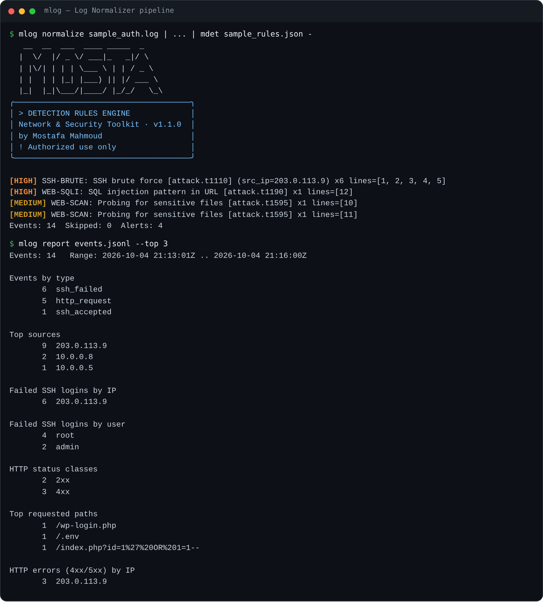
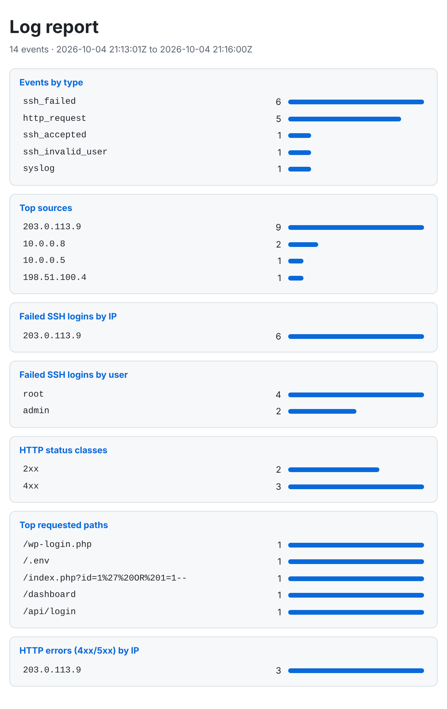

# Log Ingest



*Real run: raw SSH log to JSONL to alerts, then a summary.*

Turns raw logs into structured **JSONL**, then summarizes them (text, JSON, or a self-contained HTML report). Its output feeds the [Detection Rules Engine](../detection-rules-engine/) directly. Offline, read-only, standard library only.

## Supported inputs

| Format | Source | Events produced |
|---|---|---|
| `auth` | OpenSSH lines in `auth.log` / `secure` | `ssh_failed`, `ssh_accepted`, `ssh_invalid_user` |
| `access` | Apache / Nginx *combined* access log | `http_request` (method, path, status, bytes, user agent) |
| `syslog` | any `Mon DD HH:MM:SS host prog[pid]: message` line | `syslog` |
| `auto` (default) | tries `auth`, then `access`, then `syslog` per line | |

## Use

```bash
python3 lognorm.py normalize sample_auth.log --year 2026 > events.jsonl
python3 lognorm.py report events.jsonl --html report.html

# the whole pipeline
cat sample_auth.log | python3 lognorm.py normalize - --year 2026 \
  | python3 ../detection-rules-engine/engine.py sample_rules.json -
```

With the Mosta command layer: `mlog normalize FILE`, `mlog report FILE.jsonl`, `mdet RULES -`.

## Notes

- Syslog lines carry no year or timezone: pass `--year` and `--tz-offset` (hours from UTC); defaults are the current year and UTC.
- Lines that match no format are skipped and counted on stderr; the exit code is `1` only if nothing could be parsed.
- Normalized events keep the original line number in `line`.
- HTML report preview: 

- The HTML report escapes all log content, so hostile log lines cannot inject markup.
- Use only on logs you are authorized to analyze.
